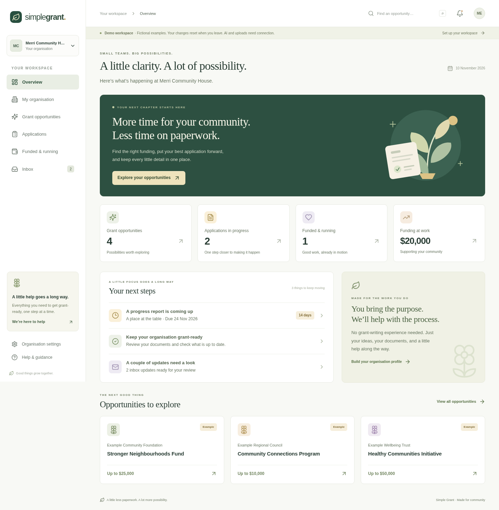

# Simple Grant

**A little less paperwork. A lot more possibility.**

An Australian grant workspace for community organisations: one login, multiple organisations, private documents, AI-assisted applications and a clear view of funded projects.



## Try the interface

```sh
npm ci
npm run dev
```

Without Supabase settings, the portal opens an explicitly labelled fictional demo. Demo changes are kept in memory only; AI, uploads and email do not pretend to be connected. Do not copy placeholder settings into `.env` to run the demo.

## Implemented

- Simple Grants-branded Resend email-link sign-in with durable email/IP request limits and app-specific session storage; shared Supabase Auth identities and several organisations under one account.
- Private, organisation-scoped document storage with database and storage row-level security, isolated in the `simple_grant` schema and `simple-grant-documents` bucket for shared Supabase projects.
- Organisation onboarding with three Gemini passes: extract, check against originals, correct, then human approval.
- Google Search-grounded discovery, user-supplied opportunity imports and saved opportunities. Eligibility remains for review; the application does not invent match scores.
- Applications gated by approved organisation facts, current guidelines, actual application questions, project information and required evidence. Editable drafts, downloads, status tracking and funder submission references.
- Award-to-project transition, original proposal, budget, milestones, expenses, evidence links and persisted AI report drafts.
- Signed, idempotent Resend inbound processing and a review inbox. **Attachment metadata is retained; actual forwarded files must currently be uploaded in the portal.**
- Optional public-only email assistance. Gemini selects an intent, then the server builds a fixed answer from name/ABN or source-backed saved grant information. Private questions go to the authenticated portal.
- Weekly/monthly/never grant-summary preferences with protected deep links, using a bounded hourly pilot worker.
- Responsive screens and keyboard-accessible dialogs.

This is a deployable first version, not a completed public-launch service. It does not submit applications, audit finances, certify eligibility, provide full conversational email support, ingest original email attachments or replace accounting software. Team invitations, malware scanning, a scalable background job queue and broader grant-source integrations are next-stage work.

## Deploy and connect your services

Read **[Deployment instructions](docs/DEPLOYMENT.md)** for Netlify settings, all environment variables, Supabase migrations, email DNS, webhooks and live validation.

The frontend uses React, TypeScript and Vite. Netlify Functions hold the Gemini and Resend keys. Supabase supplies Auth, Postgres and private Storage. Use Node 22 or later.

For Netlify: build `npm run build`, publish `dist`; the checked-in `netlify.toml` supplies functions and routing. Set browser `VITE_SUPABASE_*` values at build time, and server-only Supabase, Gemini and Resend values for Functions. **Never prefix private API keys with `VITE_`.**

For an existing shared Supabase project:

1. For a fresh installation, run **[`supabase/install-simple-grant.sql`](supabase/install-simple-grant.sql)** once in its SQL Editor. If migrations 001–004 are already installed, apply **only** [`005_auth_email`](supabase/migrations/202611100005_auth_email.sql).
2. Append `simple_grant` to the existing Data API exposed schemas.
3. Follow [Authentication](docs/AUTHENTICATION.md) to verify the Resend login sender on `simplegrants.com.au` and configure the four new login environment variables. No additional provider account is needed.
4. Configure migration 005, the four new login settings and Resend domain verification before merging/deploying `fix/simple-grants-auth` to production. Then request a fresh Simple Grants email and test sign-in and private uploads. Default preview origins cannot exercise the production login route.

Keep the shared Auth Site URL, SMTP, templates, signup settings and other redirects unchanged. Simple Grants uses its own `/auth/confirm` page; its email branding and app-local sessions do not create an independent Auth user pool. **Do not run `supabase db push`, reset or migration-history repair against the shared project.** The dedicated schema/bucket preserves unrelated tables and CLI history; earlier public-schema Simple Grant data requires a separate reviewed migration. The server service key remains privileged across the entire project. Someone with project access must apply and test hosted setup; local tests have not verified it.

Login emails use `Simple Grants <login@simplegrants.com.au>` after Resend domain verification. Other application emails still use the separate `EMAIL_FROM` setting. The original brief mentions both `thesimpleai.com` and `simpleai.com.au`. The domain is configurable. Choose an owned, verified domain; using a dedicated receiving subdomain avoids replacing an existing staff mailbox’s MX records.

## Australian grant requirements

The key rule is **follow each opportunity’s current guidelines and grant agreement**, rather than requiring the same documents from every organisation. Financial statements, audits, insurance, DGR status and auspicing are conditional requirements. A draft is not a lodged application; a recorded expense is not an audited financial acquittal.

- [Australian grants research and primary-source references](docs/AUSTRALIAN_GRANTS_RESEARCH.md)
- [Product scope, launch priorities and roadmap](docs/PRODUCT_ROADMAP.md)
- [Database and access-control design](docs/SCHEMA.md)

Official Australian source pages were blocked by the development environment’s network policy during initial research. The research document explicitly distinguishes background guidance and unverified source links from current verified rules. Recheck those primary sources and the actual funder documents before launch.

## Validation

```sh
npm test                 # backend evidence/security and draft rendering
npm run build            # TypeScript plus production frontend
npm run test:browser     # Chromium workflows; install Playwright Chromium if needed
npm run test:db          # disposable Docker/Postgres SQL and tenant-isolation tests
```

The SQL harness uses test-only Auth/Storage stubs in an isolated container. Never install those stubs in a real Supabase project. Passing local tests does not establish that live Supabase, Gemini, Resend DNS/webhooks or Netlify schedules work; follow the staging checklist with real service settings.

Cloud tasks already have isolated checkouts. Use `/workspace/simplegrants` directly; no additional Git worktree is needed.
